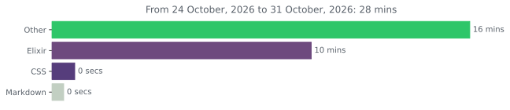

## HIHI! I'm Johmaru ┐(┐「ε:)「

Systems & AI engineer based in Yokohama, Japan.  
Focused on **compiler construction, low-level memory/runtime systems, embedded software, and LLM post-training / local inference**.

- Hugging Face: [huggingface.co/johmaru](https://huggingface.co/johmaru)
- Website: [johmaru.jp](https://johmaru.jp)

---

## LLM Post-Training & Inference

- **[gemma4-e4b-raika-lora](https://huggingface.co/johmaru/gemma4-e4b-raika-lora)** — 16-bit LoRA post-training on `gemma-4-E4B-it` for Japanese multi-turn dialogue. Built with a target-locked back-translation pipeline, automated 100% verbatim style verification, strict eval-leakage filtering, and Gemma 4-specific loss masking (`<|turn>` delimiters, thinking disabled, vision tower frozen).
- **Local Inference & Quantization** — Multi-GPU inference and quantization benchmarking (GGUF Q3/IQ4/Q4/Q8, quantized KV cache) across Gemma 4 (up to 31B) and Qwen3 families using `llama.cpp`.

## Selected Projects

### Compilers & Language Runtimes
- **[sprs](https://github.com/johmaru/sprs)** *(Rust / LLVM / Inkwell)* — Systems programming language compiler designed for embedded and low-level control.
- **[ClearLang](https://github.com/johmaru/ClearLang)** *(C++20 / ANTLR4 / LLVM)* — Statically compiled custom language featuring semantic analysis, IEEE 754 `f16`/`f32` conversions, and native Linux/Windows runtime bindings.
- **Mikazuki** *(C#)* — Custom Japanese-syntax programming language with a custom lexer/AST type checker and bytecode VM.

### Low-Level, Embedded & Native GUI
- **[NamiZig](https://github.com/johmaru/NamiZig)** *(Zig / C / Win32 / WebView2)* — Native Win32 GUI and WebView2 wrapper library with virtual host folder mapping.
- **Hardware & Emulation** — Bare-metal 64-bit RISC-V emulator in Zig, bare-metal UEFI bootloader (`PE32+` on QEMU/OVMF), and pipelined RV32I RISC-V processor in SystemVerilog (Verilator / FPGA).

## Languages & Tech Stack

- **Systems & Hardware:** Rust, Zig, C, C++20, x86/x64 Assembly, SystemVerilog
- **Compiler & Tooling:** LLVM, Inkwell, ANTLR4, CMake, Linux / Win32 API
- **AI & Web:** Python, Unsloth / PEFT / TRL, `llama.cpp`, Go, Elixir (Phoenix), C# (.NET / WPF)
